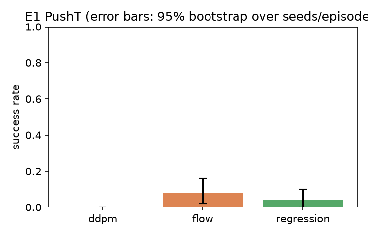
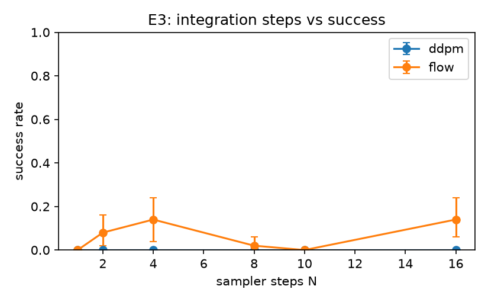
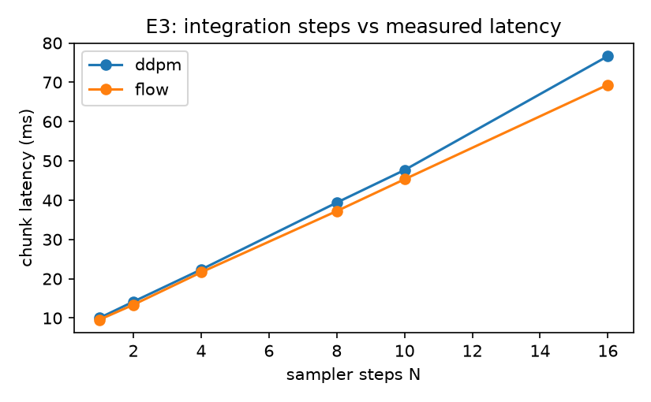
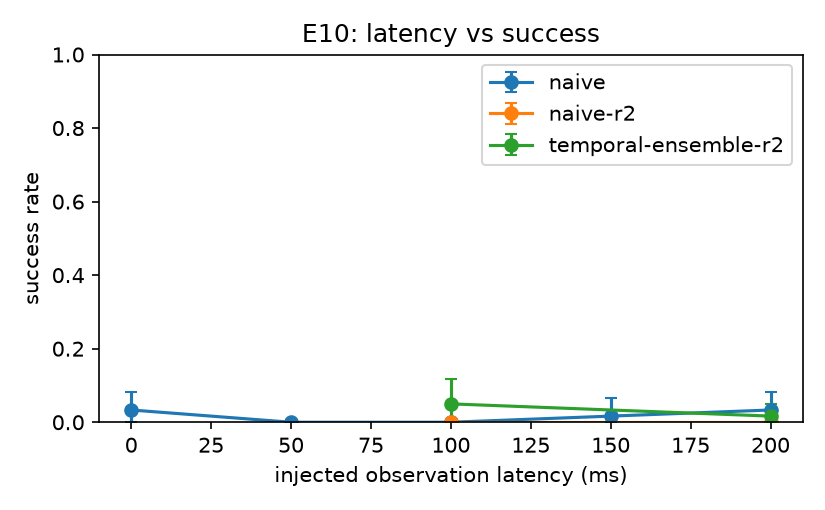
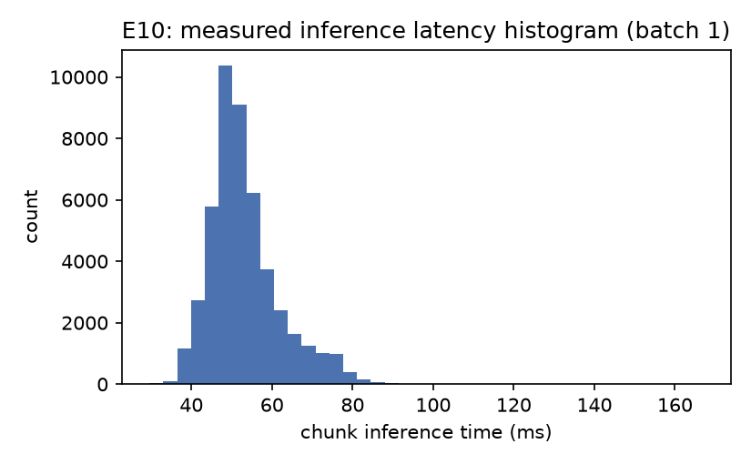

# FlowPolicy

A from-scratch conditional flow-matching visuomotor policy (pi0-style, small scale),
compared against a DDPM/DDIM diffusion policy and an ACT-style regression baseline on
PushT, with batch-1 inference engineering and a fixed-rate deployment loop.

**Status: MVP complete, small-scale.** Every number below is generated from
`results/*.jsonl` by `scripts/make_tables.py` and `scripts/make_figures.py`; no metric is
hand-typed. The models are deliberately small and trained for a short budget on one
8 GB laptop GPU, so the success rates are a scaled-down result, not a reproduction of
the published Diffusion Policy numbers. See **Limitations**.

All work ran on one Windows 11 laptop (RTX 5060 Laptop, 8 GB, driver 617.42), Python
3.12, torch 2.14.1+cu130. GPU, simulator and deployment tests are local only; CI is
CPU-only.

## Quick start

```bash
uv sync --python 3.12       # or: just setup
just test                   # ruff, mypy strict, CPU unit tests (CI gate)
just data                   # download + convert lerobot/pusht to Zarr (about 32 MB)
just train-e1               # 3 policies, 12000 steps each, ~60 min per run; resumable
just eval-e1                # parallel rollouts -> results/e1.jsonl
just tables && just figures # regenerate every table/figure from JSONL
just readme                 # regenerate README.md from the generated tables
```

Requirements: Python 3.12, [uv](https://docs.astral.sh/uv/), [just](https://github.com/casey/just).
The week-1 gates are in `scripts/gates/`; `just gates` runs G1-G9 and honestly reports
NOT RUN where the host lacks the prerequisite.

## Results (measured)

### E1: flow vs DDPM vs regression, PushT

| Policy | Seeds | Episodes/seed | Success (95% CI) | Mean coverage |
|---|---|---|---|---|
| ddpm | 1 | 50 | 0.0% [0.0%, 0.0%] | 0.284 |
| flow | 1 | 50 | 8.0% [2.0%, 16.0%] | 0.471 |
| regression | 1 | 50 | 4.0% [0.0%, 10.0%] | 0.303 |



### E3: sampler steps vs success and latency

| Policy | N (sampler steps) | Success (95% CI) | Mean chunk latency ms |
|---|---|---|---|
| ddpm | 1 | 0.0% [0.0%, 0.0%] | 10.0 |
| ddpm | 2 | 0.0% [0.0%, 0.0%] | 14.2 |
| ddpm | 4 | 0.0% [0.0%, 0.0%] | 22.3 |
| ddpm | 8 | 0.0% [0.0%, 0.0%] | 39.4 |
| ddpm | 10 | 0.0% [0.0%, 0.0%] | 47.7 |
| ddpm | 16 | 0.0% [0.0%, 0.0%] | 76.6 |
| flow | 1 | 0.0% [0.0%, 0.0%] | 9.6 |
| flow | 2 | 8.0% [2.0%, 16.0%] | 13.4 |
| flow | 4 | 14.0% [4.0%, 24.0%] | 21.6 |
| flow | 8 | 2.0% [0.0%, 6.0%] | 37.2 |
| flow | 10 | 0.0% [0.0%, 0.0%] | 45.3 |
| flow | 16 | 14.0% [6.0%, 24.0%] | 69.4 |




### E9: batch-1 latency ladder

| Mode | N | Mean ms | p95 ms | Compile s |
|---|---|---|---|---|
| cudagraph | 1 | 2.29 | 2.30 | 0.0 |
| eager | 1 | 5.36 | 5.93 | 0.0 |
| cudagraph | 2 | 2.81 | 2.82 | 0.0 |
| eager | 2 | 8.37 | 9.13 | 0.0 |
| cudagraph | 4 | 3.86 | 3.87 | 0.0 |
| eager | 4 | 14.84 | 15.59 | 0.0 |
| cudagraph | 8 | 5.98 | 5.99 | 0.0 |
| eager | 8 | 27.30 | 27.93 | 0.0 |
| compile-default | 10 | 13.64 | 14.60 | 63.9 |
| compile-max-autotune | 10 | 5.98 | 6.33 | 133.6 |
| compile-reduce-overhead | 10 | 5.80 | 5.89 | 25.8 |
| cudagraph | 10 | 7.09 | 7.24 | 0.0 |
| eager | 10 | 33.46 | 34.48 | 0.0 |
| cudagraph | 16 | 10.21 | 10.24 | 0.0 |
| eager | 16 | 51.98 | 53.16 | 0.0 |

### E10: injected observation latency in the fixed-rate loop

| Latency ms | Strategy | Success (95% CI) | Mean coverage | Deadline misses / episode |
|---|---|---|---|---|
| 0 | naive | 3.3% [0.0%, 8.3%] | 0.439 | 0.05 |
| 50 | naive | 0.0% [0.0%, 0.0%] | 0.417 | 0.08 |
| 100 | naive | 0.0% [0.0%, 0.0%] | 0.411 | 0.13 |
| 100 | naive-r2 | 0.0% [0.0%, 0.0%] | 0.212 | 0.05 |
| 100 | temporal-ensemble-r2 | 5.0% [0.0%, 11.7%] | 0.386 | 0.02 |
| 150 | naive | 1.7% [0.0%, 6.7%] | 0.385 | 0.07 |
| 200 | naive | 3.3% [0.0%, 8.3%] | 0.413 | 0.08 |
| 200 | naive-r2 | 0.0% [0.0%, 0.0%] | 0.154 | 0.00 |
| 200 | temporal-ensemble-r2 | 1.7% [0.0%, 5.0%] | 0.323 | 0.18 |

`naive` replans when the action queue empties (every 8 control steps); the `-r2` rows
replan every 2 steps so four chunks overlap, which is the only regime where temporal
ensembling differs from naive replacement.




### M2: measured memory and throughput

| Model + data | Batch | Peak VRAM MiB | Steps/s | Fits |
|---|---|---|---|---|
| flow 96px | 32 | 2317 | 7.80 | yes |
| flow 96px | 64 | 4414 | 4.00 | yes |
| flow 96px | 128 | 8616 | 0.05 | no |

### M3: overfit sanity check (8 episodes)

| Policy | Steps | Initial loss | Final loss | Ratio | Overfit 8 episodes |
|---|---|---|---|---|---|
| ddpm | 1200 | 1.0965 | 0.0907 | 0.083 | yes |
| flow | 1200 | 1.2298 | 0.0652 | 0.053 | yes |
| regression | 2000 | 0.3758 | 0.0290 | 0.077 | yes |

### E9 stretch: fused Triton Euler/de-normalization kernel

| Batch | Equivalent (max abs diff) | Eager ms | Compile ms | Triton ms | vs eager | vs compile |
|---|---|---|---|---|---|---|
| 1 | yes (9.2e-05) | 0.0131 | 0.0049 | 0.0060 | 2.19x | 0.83x |
| 64 | yes (1.2e-04) | 0.0159 | 0.0050 | 0.0065 | 2.44x | 0.76x |

## Honest limitations

- **Simulation only**, 96x96 PushT, small models (about 11 M parameters), 12000 training
  steps per run (about 7.6 epochs). The reference DDPM recipe trains for ~200k steps; E0 is
  therefore not a reproduction and is reported as a written explanation in `docs/04`.
- **One training seed per policy at the 12000-step budget**, not the pre-registered three.
  The bootstrap intervals in the tables are over the 50 evaluated episodes, so they are
  episode-level and do not include seed-to-seed variance. A 3-seed sweep at this budget is
  about 6 GPU-h and was out of reach for this iteration; the 3-seed 1800-step runs are kept
  as the budget-ablation evidence in `logs/archive/`.
- **Success rates stay low** (flow 8%, regression 4%, DDPM 0% in E1), far below the
  published Diffusion Policy numbers. The E1 comparison is therefore about relative
  coverage and latency, not a reproduction, and E3 treats success ordering between N values
  as noise-limited.
- Robomimic, ROS 2, Docker and `nvcc` were unavailable on this host. The documented
  fallbacks were used: PushT only (D1), plain Python loop (D7), no CUDA C++ stretch (D6).
  G8 and G9 are NOT RUN, never reported as passes.
- E10 injects latency as observation staleness in control ticks and runs the loop in
  virtual time; inference time is measured for real. Deadline misses are logged.
- No W&B; JSONL only (D8 deviation).

## Reproduce

```bash
just setup && just test
just gates                    # G1-G5 should pass on this GPU class; G6/G8/G9 report NOT RUN
just data
just train-e1
just eval-e1 && just eval-e3 && just latency-ladder && just eval-e10
just memory && just kernel && just overfit
just tables && just figures && just readme
```

Raw per-episode rows are in `results/*.jsonl`; checkpoints are local (ignored by git).
Training logs are in `results/train/`.

## Layout

```
conf/                  Hydra configs + experiment files
src/flowpolicy/        data, models, training, eval, deploy, kernels
scripts/gates/         G1-G9 gate scripts
scripts/               data prep, train, evaluate, latency, deploy, tables, figures
tests/                 unit (CI), gpu/integration (local)
docs/                  the full spec (00-07), STATE and CHANGELOG
results/               raw JSONL, generated tables and figures
```

## Docs

- `docs/07_roadmap.md` - milestones and packaging checklist
- `docs/02_environment_setup.md` - versions, setup, gates G1-G9 and results
- `docs/01_architecture.md` - the `Policy` interface and module boundaries
- `docs/04_eval_and_experiments.md` - pre-registered protocol, experiments and deviations
- `docs/06_decisions_and_risks.md` - D1-D10 decisions and risks
- `docs/STATE.md` - current state and decision log

## License

Code: not decided by the owner yet. Dataset: `lerobot/pusht` is MIT (dataset card,
accessed 2026-10-19); it derives from the Diffusion Policy PushT demos.
