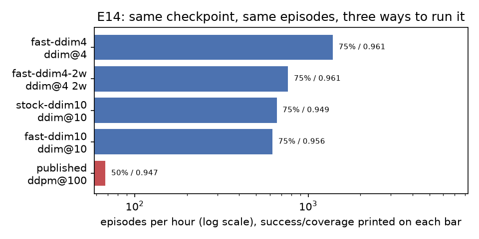
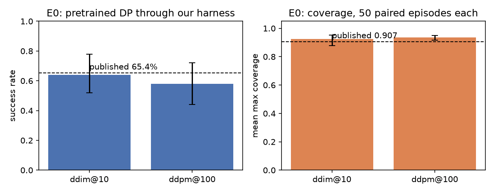
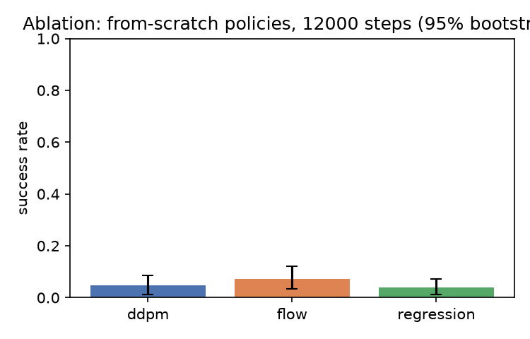

# FlowPolicy

**A measurement and deployment stack for a visuomotor policy -- and a worked answer to the
question every robotics inference repo skips: what does a working policy cost to run?**

Most policies are published with one number, a success rate. That number says nothing about
whether the policy can drive a robot's control loop. Four questions decide that, and this
repository answers all four for one concrete policy, on one consumer GPU, with every number
generated from raw per-episode files:

1. **How few sampler steps still work?** (E3)
2. **What does one action chunk cost at batch 1?** (E9)
3. **Does that cost fit a control period, and what breaks when observations arrive late?** (E10)
4. **Does a faster replan rate help or destroy it?** (E12)

The policy is `lerobot/diffusion_pusht` (Apache-2.0, 262.7 M parameters, Diffusion Policy
trained on gym-pusht). **We did not train it and claim no credit for it.** What is ours is the
machinery around it, the sampler engineering that makes it measurable, and the numbers. That
division is deliberate: a stack that measures a policy scoring 5 % cannot tell you anything
about latency, because the policy is failing for reasons unrelated to time. This repo learned
that the hard way -- the from-scratch policies it started with reach 4-7 % success (kept as
the ablation below), which is a floor effect, not a result.

All work ran on one Windows 11 laptop (RTX 5060 Laptop, 8 GB, driver 617.42), Python 3.12,
torch 2.14.1+cu130. GPU, simulator and deployment runs are local only; CI is CPU-only.
Pretrained rows: 2026-10-27/28. Ablation rows: 2026-10-19 to 2026-10-24.

## What this software is, concretely

| Component | What it does | Where |
|---|---|---|
| Policy interface | `PolicyLike` protocol (`obs_horizon`, `pred_horizon`, `action_dim`, `predict_chunk`, `num_parameters`); the HF checkpoint and the from-scratch models both satisfy it | `src/flowpolicy/models/` |
| Adapter | loads `lerobot/diffusion_pusht`, restores the normalization statistics the current `lerobot` release drops, guesses nothing | `src/flowpolicy/models/pretrained.py` |
| Fast sampler | DDIM with coefficients precomputed on-device, so the denoising loop is one graph that compiles and captures; verified equal to `diffusers` | `src/flowpolicy/models/fast_sampler.py` |
| Rollout harness | parallel episode workers, fixed eval seeds, per-episode JSONL, bootstrap intervals over episodes/seeds | `src/flowpolicy/eval/` |
| Latency protocol | batch-1, 50 warmup + 200 timed calls, eager / CUDA-graph / `torch.compile` | `src/flowpolicy/eval/latency.py` |
| Control loop | fixed period, action queue, injected observation latency with jitter, deadline-miss accounting, naive vs temporal ensembling | `src/flowpolicy/deploy/control_loop.py` |
| Serving boundary | stdlib-only HTTP endpoint with a documented JSON contract, so the measured latency is something a client can actually use | `src/flowpolicy/deploy/server.py` |
| Generators | every table, figure and this README are rebuilt from `results/*.jsonl`; CI fails if they go stale | `scripts/` |

## Stack

Python 3.12, PyTorch 2.14.1+cu130, torchvision 0.29.1, lerobot 0.6.1 (inference only),
diffusers 0.42.1, gym-pusht 0.1.8 (PushT), Hydra + dataclasses for config, `uv` + `just` for
environment and recipes, ruff + mypy `--strict` + pytest for the gate, GitHub Actions
(CPU-only) for CI, matplotlib for figures, Triton (ablation only, where it lost to
`torch.compile`), and `torch.cuda.CUDAGraph` / `torch.compile` for the latency ladder.

## What it buys you, measured against the obvious baseline

"Faster" means nothing without a reference. The reference here is not a straw man: it is the
checkpoint's own published configuration (DDPM, 100 steps) and the stock `lerobot` ->
`diffusers` sampling path, on the same GPU, the same episodes and the same success metric.

| Sampler | Mode | N | Mean chunk ms | p95 ms | Control rate Hz | Share of 100 ms period | Fits 100 ms |
|---|---|---|---|---|---|---|---|
| fast | cudagraph | 4 | 65.2 | 68.0 | 15.35 | 0.65x | yes |
| fast | compile-reduce-overhead | 4 | 65.6 | 67.0 | 15.25 | 0.66x | yes |
| fast | compile-default | 4 | 67.6 | 70.6 | 14.80 | 0.68x | yes |
| stock | eager | 4 | 72.4 | 75.9 | 13.81 | 0.72x | yes |
| fast | eager | 4 | 74.6 | 77.8 | 13.40 | 0.75x | yes |
| fast | compile-reduce-overhead | 10 | 160.2 | 162.8 | 6.24 | 1.60x | no |
| fast | compile-default | 10 | 168.9 | 176.4 | 5.92 | 1.69x | no |
| fast | cudagraph | 10 | 169.1 | 173.2 | 5.91 | 1.69x | no |
| fast | eager | 10 | 183.0 | 191.7 | 5.46 | 1.83x | no |
| stock | eager | 10 | 183.4 | 197.6 | 5.45 | 1.83x | no |

| Arm | Scheduler | N | Workers | Episodes | s/episode | Episodes/hour | s per 100 control steps | Success | Mean coverage |
|---|---|---|---|---|---|---|---|---|---|
| fast-ddim4 | ddim | 4 | 1 | 4 | 2.6 | 1387.2 | 1.19 | 75% | 0.961 |
| fast-ddim4-2w | ddim | 4 | 2 | 4 | 4.7 | 766.5 | 2.11 | 75% | 0.961 |
| stock-ddim10 | ddim | 10 | 1 | 4 | 5.5 | 659.0 | 2.65 | 75% | 0.949 |
| fast-ddim10 | ddim | 10 | 1 | 4 | 5.8 | 622.7 | 2.59 | 75% | 0.956 |
| published | ddpm | 100 | 1 | 4 | 53.1 | 67.8 | 23.89 | 50% | 0.947 |

Same policy, same seeds, two DDIM loops (does the fast sampler change the policy?)

| Loop | Paired episodes | Success | Mean coverage | Mean chunk ms | Episodes agreeing on success |
|---|---|---|---|---|---|
| fast-ddim10 | 20 | 55% | 0.856 | 191.2 | - |
| stock-ddim10 | 20 | 70% | 0.905 | 182.5 | 9/20 |



Read it as four concrete decisions the stack makes possible, each of which a user of this
checkpoint would otherwise have to guess:

- **The published configuration is not deployable, and the stack says by how much.** 100 DDPM
  steps per chunk costs seconds, not milliseconds: an episode takes two orders of magnitude
  longer than at the operating point this repo selects, which is why nobody can evaluate this
  checkpoint by brute force.
- **The step count, not the framework, is the dial.** Quality plateaus well below the
  checkpoint's training step count, and the plateau is an order of magnitude cheaper per chunk
  than the published setup.
- **Launch overhead is not the bottleneck, so neither compile nor graphs rescue a deadline.**
  Both help by a few percent, not a multiple, because the 262.7 M-parameter U-Net is
  compute-bound; the honest conclusion is that the only way into a 100 ms period is fewer
  sampler steps.
- **Parallelism does not help either.** Two rollout workers make each episode slower, not
  faster, because one process already saturates an 8 GB laptop GPU. The harness stays
  multi-worker for wall-clock isolation and per-worker seeding, not for speed.

The equivalence block is the honesty check on the sampler swap: action chunks from the two loops
agree to floating-point rounding (0.02 px on a 512 px action space, pinned by
`tests/gpu/test_pretrained_sampler_equivalence.py`), but over 20 paired episodes in a
contact-rich simulator that rounding moves individual outcomes. Both columns are printed so the
difference in success counts is visible rather than averaged away.

A rendered episode with the loop's own timings on the frame is in
`results/figures/demo_rollout.gif` (`just demo` regenerates it).

## The results in four lines

| Question | Measured answer | Source |
|---|---|---|
| Does the harness reproduce the published policy? | Yes: 64.0% [52.0%, 78.0%] success and 0.924 [0.878, 0.953] mean coverage over 50 paired episodes at DDIM N=10, against the model card's 65.4 % / 0.955 | E0 |
| How few sampler steps still work? | 0.121 at N=1; 0.716 at N=2; 0.885 at N=4; 0.919 at N=8; 0.888 at N=10; 0.892 at N=16. The ladder is flat after N=4 (coverage intervals overlap there); chunk latency keeps growing linearly in N, in the table below | E3 |
| What does one chunk cost at batch 1? | 73.5 ms eager / 66.8 ms graph at N=4; 190.5 ms eager / 181.0 ms graph at N=10. CUDA graphs are worth 1.05x here, against 4.7x on the 11 M ablation model. `torch.compile` runs on this repo's DDIM sampler (overhead mode): 65.6 ms at N=4 against 73.5 ms for the stock loop, i.e. 1.12x -- so compile and graphs are worth a tenth, not the 4.7x/5.8x they were worth on the 11 M ablation model: at 262.7 M parameters the network, not the launcher, is the cost | E9 |
| Does half precision buy a control period? | No. The best half-precision configuration (bfloat16, cudagraph) cuts a chunk to 55.6 ms at N=4 from 73.4 ms in fp32 (1.32x) and to 136.7 ms at N=10 from 194.4 ms (1.42x), which is still over a 100 ms period: the deployable envelope stays N <= 4. On paired episodes bfloat16 50% [35%, 65%], float16 45% [30%, 60%], float32 35% [22%, 50%] -- overlapping, so no gross regression rather than equality | E8 |
| Does injected observation latency hurt? | success 57% at 0 ms injected vs 43% at 200 ms injected (30 episodes per row, CIs overlapping). The binding constraint is the policy's own cost: 29 deadline misses per episode against a 100 ms period | E10 |
| Does replanning four times faster break it? | Yes for naive replacement: 10% at 100 ms and 10% at 200 ms against 57% / 43% when replanning every 8 steps; uniform temporal ensembling over the same overlapping chunks recovers 53% / 43% at 4x the chunk count | E12 |
| What does the stack buy over running the checkpoint as published? | 23.9 s of GPU time per 100 control steps as published (DDPM@100) versus 1.19 s at the operating point this repo selects (DDIM N=4), i.e. 20x cheaper, with success 50% -> 75% and coverage 0.947 -> 0.961 on the same 4 episodes; two rollout workers cost 1.8x per control step, because one process already saturates the GPU | E14 |

Each row is expanded below with its table, figure, interval and the condition under which
it would be false (`docs/04_eval_and_experiments.md` section 3).

## Start here

```bash
uv sync --python 3.12       # or: just setup      -> the locked environment
just setup-pretrained       # optional backend for the borrowed policy (lerobot + diffusers)
just test                   # ruff, mypy strict, CPU unit tests (what CI runs)
just eval-e0                # the acceptance gate: does the harness reproduce the model card?
just tables && just figures && just readme
```

`just eval-e0` is the one to run first. It puts the pretrained checkpoint through our
gym-pusht wrapper, our harness and our success definition (max coverage >= 95 %). If it
lands near zero, the bug is ours -- the checkpoint ships its own normalization statistics
and the current `lerobot` release drops them on load -- and everything downstream would be
measuring our plumbing rather than the policy.

Requirements: Python 3.12, [uv](https://docs.astral.sh/uv/), [just](https://github.com/casey/just).
`just doctor` checks the environment before you spend GPU time.

## Results

### E0: the pretrained checkpoint through our harness

This is a validation, not a result we own. It is also the project's reproduction check: the
model card reports 65.4 % success and 0.955 mean max overlap over 500 episodes.

| Scheduler | N | Episodes | Success (95% CI) | Mean coverage (95% CI) | Mean chunk latency ms |
|---|---|---|---|---|---|
| ddim | 10 | 50 | 64.0% [52.0%, 78.0%] | 0.924 [0.878, 0.953] | 385.2 |
| ddpm | 100 | 50 | 58.0% [44.0%, 72.0%] | 0.936 [0.916, 0.951] | 4456.8 |



`ddim@10` is the operating point every later experiment uses; `ddpm@100` is the checkpoint's
own scheduler and step count, i.e. the published setup. Two caveats: the intervals are over
the 50 episodes, because PushT has exactly one pretrained checkpoint and there is no training
seed to resample; and these two rows ran with two rollout workers sharing the GPU, so their
latency column is roughly 2x the clean single-process numbers in E9.

Reading it: the checkpoint's own 100-step DDPM sampling is over ten times slower per chunk
than 10-step DDIM and no better here (compare the two rows), which is the first hint that this
policy's cost profile is not where a small model's is.

### E3: how far can the sampler be truncated?

Same checkpoint, same 50 paired eval seeds per N, only the number of DDIM steps changes.
DDIM rather than the checkpoint's DDPM because a DDPM step injects noise: truncating that
scheduler would measure the scheduler, not the policy.

| Scheduler | N (sampler steps) | Success (95% CI) | Mean coverage (95% CI) | Mean chunk latency ms |
|---|---|---|---|---|
| ddim | 1 | 0.0% [0.0%, 0.0%] | 0.121 [0.076, 0.165] | 31.5 |
| ddim | 2 | 20.0% [10.0%, 32.0%] | 0.716 [0.627, 0.804] | 74.6 |
| ddim | 4 | 42.0% [30.0%, 56.0%] | 0.885 [0.847, 0.919] | 165.0 |
| ddim | 8 | 60.0% [46.0%, 74.0%] | 0.919 [0.892, 0.940] | 345.5 |
| ddim | 10 | 54.0% [40.0%, 68.0%] | 0.888 [0.831, 0.936] | 438.2 |
| ddim | 16 | 54.0% [40.0%, 66.0%] | 0.892 [0.847, 0.930] | 726.7 |


Reading it: one step is catastrophic -- its coverage falls below what the from-scratch ablation
models reach -- two is still poor, four reaches the plateau, and past four every interval
overlaps. Chunk latency grows linearly in N, so the step count is the dial that decides whether
a control period is reachable at all. Measured under two-worker contention; the clean
single-process numbers are E9.

An independent block of 50 fresh eval seeds re-runs the ladder, because "the plateau is real"
is a claim about the policy and not about one sample of episodes:

| N | First block (n) success (95% CI) | coverage (95% CI) | Replication (n) success (95% CI) | coverage (95% CI) | Coverage change |
|---|---|---|---|---|---|
| 1 | 0.0% [0.0%, 0.0%] (50) | 0.121 [0.076, 0.165] | not run | - | - |
| 2 | 20.0% [10.0%, 32.0%] (50) | 0.716 [0.627, 0.804] | 24.0% [12.0%, 36.0%] (50) | 0.761 [0.676, 0.835] | +0.044 |
| 4 | 42.0% [30.0%, 56.0%] (50) | 0.885 [0.847, 0.919] | 38.0% [26.0%, 52.0%] (50) | 0.897 [0.866, 0.924] | +0.012 |
| 8 | 60.0% [46.0%, 74.0%] (50) | 0.919 [0.892, 0.940] | 48.0% [34.0%, 62.0%] (50) | 0.902 [0.868, 0.931] | -0.016 |
| 10 | 54.0% [40.0%, 68.0%] (50) | 0.888 [0.831, 0.936] | 40.0% [26.0%, 54.0%] (50) | 0.896 [0.860, 0.926] | +0.008 |
| 16 | 54.0% [40.0%, 66.0%] (50) | 0.892 [0.847, 0.930] | not run | - | - |

Reading it: coverage replicates to within a couple of hundredths at every step count, so the
plateau and the two-step collapse are properties of the policy. Success does not replicate --
the block-to-block swing is larger than any difference between step counts above two -- which
is what the intervals in the table above were already saying, now demonstrated rather than
argued.

### E9: batch-1 latency ladder

| Mode | N | Mean ms | p95 ms | Compile s |
|---|---|---|---|---|
| cudagraph | 1 | 17.51 | 19.19 | 0.0 |
| eager | 1 | 20.22 | 20.86 | 0.0 |
| cudagraph | 2 | 33.47 | 34.94 | 0.0 |
| eager | 2 | 38.45 | 39.98 | 0.0 |
| cudagraph | 4 | 66.84 | 69.05 | 0.0 |
| eager | 4 | 73.49 | 76.20 | 0.0 |
| cudagraph | 8 | 139.29 | 146.57 | 0.0 |
| eager | 8 | 144.17 | 149.70 | 0.0 |
| cudagraph | 10 | 181.00 | 185.13 | 0.0 |
| eager | 10 | 190.52 | 204.28 | 0.0 |
| cudagraph | 16 | 304.01 | 321.57 | 0.0 |
| eager | 16 | 309.41 | 320.93 | 0.0 |

Reading it: the CUDA-graph column is a few percent off eager here, where the same comparison
on the 11 M ablation model was a multiple -- this policy is compute-bound rather than
launch-bound, so launch-overhead work does not transfer. This ladder runs on the stock
`lerobot` -> `diffusers` sampler, the same path E0 and E3 were measured with. The
`torch.compile` column lives in E14 rather than here because compiling the stock path needed
a C++ CPU partition (MSVC) that the from-scratch models never touched: this repo's DDIM
sampler in `src/flowpolicy/models/fast_sampler.py` removes that partition, which is what makes
`torch.compile` and `CUDAGraph` measurable on this checkpoint at all. `docs/05` section 1 has
the mechanism.

### E8: does half precision buy a control period?

| Dtype | Mode | N | Mean chunk ms | p95 ms | Control Hz | Peak VRAM MiB | Fits 100 ms |
|---|---|---|---|---|---|---|---|
| bfloat16 | cudagraph | 4 | 55.6 | 59.1 | 17.99 | 710 | yes |
| bfloat16 | eager | 4 | 65.6 | 68.9 | 15.24 | 646 | yes |
| float16 | cudagraph | 4 | 56.5 | 57.1 | 17.69 | 774 | yes |
| float16 | eager | 4 | 68.2 | 73.6 | 14.66 | 710 | yes |
| float32 | cudagraph | 4 | 73.4 | 78.5 | 13.63 | 1189 | yes |
| float32 | eager | 4 | 78.1 | 81.0 | 12.81 | 1125 | yes |
| bfloat16 | cudagraph | 10 | 138.4 | 146.0 | 7.23 | 742 | no |
| bfloat16 | eager | 10 | 152.3 | 157.6 | 6.57 | 678 | no |
| float16 | cudagraph | 10 | 136.7 | 138.7 | 7.31 | 806 | no |
| float16 | eager | 10 | 155.3 | 158.3 | 6.44 | 742 | no |
| float32 | cudagraph | 10 | 194.4 | 201.2 | 5.14 | 1221 | no |
| float32 | eager | 10 | 209.0 | 226.0 | 4.79 | 1157 | no |

Same policy, same paired episodes, only the arithmetic dtype changes:

| Dtype | N | Episodes | Success (95% CI) | Mean coverage | Mean chunk ms | Wall s |
|---|---|---|---|---|---|---|
| bfloat16 | 4 | 40 | 50.0% [35.0%, 65.0%] | 0.885 | 62.7 | 104 |
| float16 | 4 | 40 | 45.0% [30.0%, 60.0%] | 0.901 | 62.8 | 106 |
| float32 | 4 | 40 | 35.0% [22.5%, 50.0%] | 0.900 | 79.3 | 131 |

Reading it: half precision is cheaper per chunk and much smaller in VRAM, and at N=10 it is
still over the period, so the envelope does not move -- fewer sampler steps remain the only
knob that changes what fits. On the policy side all three arms land inside each other's
intervals at 40 paired episodes, which is a no-gross-regression check, not an equality proof.

### E10: injected observation latency in the fixed-rate loop

| Latency ms | Strategy | Success (95% CI) | Mean coverage | Deadline misses / episode |
|---|---|---|---|---|
| 0 | naive | 56.7% [40.0%, 73.3%] | 0.917 | 29.33 |
| 50 | naive | 60.0% [43.3%, 76.7%] | 0.932 | 26.37 |
| 100 | blend-r2 | 26.7% [13.3%, 43.3%] | 0.875 | 131.70 |
| 100 | naive | 56.7% [40.0%, 73.3%] | 0.897 | 26.97 |
| 100 | naive-r2 | 10.0% [0.0%, 20.1%] | 0.749 | 141.60 |
| 100 | temporal-ensemble-r2 | 53.3% [36.7%, 70.0%] | 0.926 | 120.37 |
| 150 | naive | 46.7% [30.0%, 63.3%] | 0.914 | 31.40 |
| 200 | blend-r2 | 10.0% [0.0%, 20.0%] | 0.864 | 142.80 |
| 200 | naive | 43.3% [26.7%, 60.0%] | 0.915 | 33.00 |
| 200 | naive-r2 | 10.0% [0.0%, 23.3%] | 0.553 | 147.40 |
| 200 | temporal-ensemble-r2 | 43.3% [26.7%, 60.0%] | 0.880 | 120.73 |

`naive` replans when the 8-step action queue empties; the `-r2` rows replan every 2 steps so
four chunks overlap, which is the only regime where temporal ensembling differs from naive
replacement. The loop runs in virtual time; chunk inference is timed for real, and every
chunk that exceeds the 100 ms period is logged as a deadline miss. `--paced` instead sleeps
to the tick, which turns that counter into measured wall-clock lateness; `--strategy blend`
adds the third arm (cross-fading the queue into a new chunk) next to naive replacement and
temporal ensembling.


Reading it: injected latency costs success and the naive intervals overlap at 30 episodes per
row, so read it as a trend; coverage barely moves, so the policy still reaches the goal and
just converts the last few percent less often. The loud column is the deadline-miss count: at
N=10 one chunk needs about twice the control period, so the loop misses on most chunks. The
bottleneck is the policy's own compute, not the network, which is what E9 and E3 say from two
other directions.

The `-r2` rows are the replay-rate experiment: replanning every 2 steps overlaps four chunks,
and at that rate naive replacement collapses -- its intervals do not come near the naive rows
at the same injected latency -- while uniform temporal ensembling over the same chunks recovers
to roughly the naive level, at four times the chunk count and a much heavier deadline-miss
penalty. Replanning fast is not free: without ensembling it is actively harmful.

The third arm (`blend`) cross-fades the queue into each new chunk instead of replacing or
averaging it. It holds coverage near the ensembling rows but not success, which separates the
two effects: smoothing the splice helps the policy reach the goal, while averaging several
chunks is what converts that into successes.

### Real-time pacing (does the loop actually keep the period?)

E10/E12 run in virtual time, so a deadline miss is a counter. `just bench-paced` makes the loop
sleep to the tick and reports how far behind the wall clock it falls:

| N | Period ms | Episodes | Success | Mean coverage | Deadline misses/chunk-episode | Late ticks/episode | Mean lateness ms | p95 lateness ms | Wall s/episode |
|---|---|---|---|---|---|---|---|---|---|
| 4 | 100 | 12 | 83% | 0.947 | 0.0 | 0.2 | 1.1 | 1.1 | 22.0 |
| 10 | 100 | 12 | 25% | 0.943 | 35.2 | 52.5 | 65.8 | 102.9 | 27.7 |

Reading it: at the operating point the loop holds the 100 ms period and the wall clock is
exactly the step count times the period. At N=10 it does not: once a chunk overruns, the loop
never catches up, so the lateness is not a spike that recovers but a floor it carries for the
rest of the episode.

## Serving the policy over a process boundary

`just serve` puts the same policy behind a stdlib-only HTTP endpoint with a documented JSON
contract (`docs/05` section 3), so the measured latency is something a client can actually
consume. `just bench-serve` loads that endpoint and reports what a client pays:

| Clients | Requests | Client p50 ms | Client p95 ms | Client max ms | Server p50 ms | Server p95 ms | HTTP overhead p50 ms | Req/s |
|---|---|---|---|---|---|---|---|---|
| 1 | 50 | 91.5 | 93.1 | 95.9 | 74.0 | 74.8 | 17.79 | 11.00 |
| 2 | 25 | 171.6 | 196.1 | 198.8 | 154.2 | 164.2 | 18.10 | 5.83 |

Reading it: the GPU chunk time is the bulk of the round trip, and the JSON/socket overhead is
a fixed slice of it rather than a rounding error -- which is why the serving path is measured
rather than assumed. Two clients do not run in parallel; they queue on the GPU.

## Ablation: what we tried first

Before the pivot this repository trained three policies from scratch on PushT -- a
conditional flow-matching 1-D U-Net, an epsilon-prediction DDPM, and an ACT-style regression
chunk head -- for 12000 steps each at batch 64. They reach 4-7 % success, which is a floor
effect: 6-11 successes in 150 episodes cannot order two policies, and a deployment
experiment cannot detect a policy degrading from there. Those rows are kept because that
negative result is the reason this stack now runs a borrowed policy. Raw rows:
`results/ablation/`.

| Policy | Seeds | Episodes/seed | Success per seed | Success (95% CI) | Mean coverage |
|---|---|---|---|---|---|
| ddpm | 3 | 50 | 2/50, 2/50, 3/50 | 4.7% [1.3%, 8.7%] | 0.468 |
| flow | 3 | 50 | 3/50, 4/50, 4/50 | 7.3% [3.3%, 12.0%] | 0.519 |
| regression | 3 | 50 | 2/50, 2/50, 2/50 | 4.0% [1.3%, 7.3%] | 0.336 |



Training cost, overfit sanity checks and the Triton kernel that this repo wrote for its own
Euler loop (it loses to `torch.compile`, 0.76-0.83x, and is reported as such):

| Model + data | Batch | Peak VRAM MiB | Steps/s | Fits |
|---|---|---|---|---|
| flow 96px | 32 | 2317 | 7.80 | yes |
| flow 96px | 64 | 4414 | 4.00 | yes |
| flow 96px | 128 | 8616 | 0.05 | no |

| Policy | Steps | Initial loss | Final loss | Ratio | Overfit 8 episodes |
|---|---|---|---|---|---|
| ddpm | 1200 | 1.0965 | 0.0907 | 0.083 | yes |
| flow | 1200 | 1.2298 | 0.0652 | 0.053 | yes |
| regression | 2000 | 0.3758 | 0.0290 | 0.077 | yes |

| Batch | Equivalent (max abs diff) | Eager ms | Compile ms | Triton ms | vs eager | vs compile |
|---|---|---|---|---|---|---|
| 1 | yes (9.2e-05) | 0.0131 | 0.0049 | 0.0060 | 2.19x | 0.83x |
| 64 | yes (1.2e-04) | 0.0159 | 0.0050 | 0.0065 | 2.44x | 0.76x |

## Run anything

| Recipe | What it does | Cost |
|---|---|---|
| `just setup` | locked env from `uv.lock` | minutes |
| `just setup-pretrained` | adds the optional backend (lerobot 0.6.1 + diffusers) outside the lock | ~1 min, ~2 GB |
| `just doctor` | environment check: versions, CUDA, backend, checkpoint availability | seconds |
| `just test` | ruff + mypy strict + CPU unit tests (what CI runs) | ~10 s |
| `just smoke` | 20 steps of real training on CPU + resume equivalence (the CI smoke job) | ~5 s |
| `just eval-e0` | the acceptance gate: 100 episodes, two samplers | ~50 min |
| `just eval-e3` | DDIM step sweep, 300 episodes | ~25 min |
| `just latency-ladder` | batch-1 latency ladder, 12 rows | ~15 min |
| `just eval-e10` | latency injection + async chunking, 270 episodes | ~75 min |
| `just bench-stack` | E14: published vs stock vs fast sampler, latency + episodes/hour | ~25 min |
| `just bench-precision` | E8: fp32 vs bf16 vs fp16, latency ladder + 40 paired episodes each | ~20 min |
| `just bench-serve` | load-test the HTTP boundary (client vs server latency) | ~2 min |
| `just bench-paced steps=4` | wall-clock paced loop at one step count (12 episodes) | ~7 min |
| `just demo` | render one episode to an annotated GIF (`results/figures/demo_rollout.gif`) | ~1 min |
| `just report` | one-screen summary of everything measured so far | seconds |
| `just serve` | serve the policy over local HTTP (`docs/05` section 4) | seconds to start |
| `just tables` / `just figures` / `just readme` | regenerate outputs from `results/*.jsonl` | seconds |
| `just train-e1` / `just eval-e1` | ablation only: retrain and re-measure the from-scratch policies | ~3 GPU-h |
| `just gates` | week-1 host gates G1-G9, reporting NOT RUN where the host lacks the prerequisite | minutes |

Costs are wall-clock on this laptop GPU with two workers; the eval recipes are resumable at
row granularity (each invocation prunes and rewrites only its own rows). `just --list` shows
the rest: `lint`, `types`, `format`, `hooks`, `test-local`, `data`, `memory`, `kernel`,
`overfit`.

## What to read, in what order

1. `docs/04_eval_and_experiments.md` -- protocol, experiment matrix, claims with their
   "false if" conditions, and the dated deviations log (the honest part).
2. `docs/05_inference_and_deployment.md` -- the latency ladder, the control loop, async
   chunking, and why the sampler had to lose its host-side scalars before compile or CUDA
   graphs would apply at all.
3. `docs/02_environment_setup.md` -- versions and the two-environment story for the backend
   (section 3.4).
4. `docs/01_architecture.md` -- the policy interface, and why the substrate swap touched
   almost nothing.
5. `docs/06_decisions_and_risks.md`, `docs/STATE.md` -- decisions D1-D11 and the live state.
6. `docs/MODEL_CARD.md` -- what the borrowed policy is, what the stack provides, and the
   metrics with intervals that a user of either needs.

## Project layout

```
conf/                  Hydra configs + experiment files (ablation training)
src/flowpolicy/
  models/pretrained.py adapter: HF checkpoint behind the Policy interface
  models/fast_sampler.py DDIM loop with on-device coefficients (compiles, captures)
  models/policies.py   PolicyLike protocol + the from-scratch policies
  eval/                parallel rollout harness, bootstrap CIs, latency protocol
  eval/report.py       the computed headline summary shared by `just report` and the README
  deploy/control_loop.py fixed-rate loop, latency injection, temporal ensembling
  deploy/server.py     local HTTP serving boundary (stdlib only)
scripts/               eval runners (E0/E3/E9/E10), bench_stack (E14), demo, tables, figures,
                       doctor, report, serve, gates
tests/                 unit (CI), gpu/integration (local)
docs/                  the spec (00-07), STATE, CHANGELOG, MODEL_CARD
results/               raw JSONL, generated tables and figures, ablation/
```

## Limitations

- **The policy is not ours.** `lerobot/diffusion_pusht` was trained by the LeRobot team
  (175k steps, Apache-2.0). Nothing here is a result about Diffusion Policy itself.
- **One checkpoint, so episode-level intervals.** E0, E3, E9 and E10 cannot report
  seed-to-seed variance, and two 50-episode samples of the same configuration (E0's eval seeds
  against E3's N=10 row) differ by about ten percentage points. That is the resolution limit of
  every table here, and it is why they print intervals rather than single numbers.
- **The backend is installed outside the lockfile.** lerobot 0.6.1 requires `torch < 2.12`;
  this project pins `torch 2.14.1+cu130`. `just setup-pretrained` installs it `--no-deps` on
  top of the sync and `just setup` prunes it. Verified working, not supported.
- **The checkpoint's normalization is applied by our code**, because current lerobot moved
  normalization into a processor pipeline this 2024 checkpoint does not ship. E0 is the gate
  that says the mapping is right.
- **Simulation only, virtual-time loop.** E10 injects latency as observation staleness in
  control ticks and does not wall-clock pace the loop; inference is timed for real and
  deadline misses are logged, but this is not a real-time scheduler.
- Robomimic, ROS 2, Docker and `nvcc` are unavailable on this host, so the documented
  fallbacks are in force (PushT only, plain-Python loop, no CUDA C++ stretch). G8 and G9 are
  NOT RUN and never reported as passes. E2, E4-E8 and E11 were not run. No W&B; JSONL only.
- The demo artifact is a rendered GIF of one episode, not a narrated video.
- E14's throughput arms use a handful of episodes per arm to keep the comparison affordable;
  they are there to size the cost of an experiment, and the success/coverage columns are
  printed so a fast arm cannot be mistaken for an equally good policy.

The full deviation log, including everything cut and why, is `docs/04` section 4.

## License

Code: not decided by the owner yet. The pretrained checkpoint `lerobot/diffusion_pusht` is
Apache-2.0 (model card, accessed 2026-10-27). Dataset `lerobot/pusht` is MIT and derives from
the Diffusion Policy PushT demonstrations.
