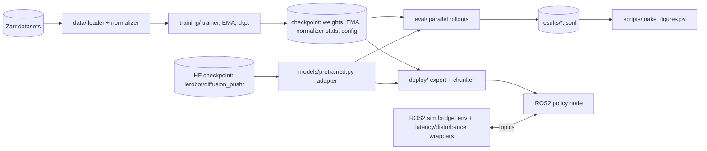

# 01. Architecture, repo, CI

Tags: [V] verified, [S] secondary source, [U] unverified (coding agent must confirm). Links: [00](00_overview.md) [03](03_data_models_training.md) [05](05_inference_and_deployment.md) [07](07_roadmap.md)

## 1. System diagram



Since 2026-10-27 (D11) the policy eval and deploy load is normally the HF checkpoint via the
adapter (bottom right), not a trained `CK`. Both satisfy the same interface, which is why the
episode loop, the control loop, the latency ladder and the tables did not change when the
substrate did.

## 2. Module boundaries and interfaces

All three policies implement one interface, so eval, export, and deploy never branch on policy type.

```python
class Policy(nn.Module):
    def loss(self, batch: Batch) -> dict[str, Tensor]: ...            # training; must include "loss"
    @torch.no_grad()
    def predict_chunk(self, obs: Obs, **sampler_kw) -> Tensor: ...    # [B, Tp, Da], de-normalized
Batch = {"image": [B,To,C,H,W] float, "state": [B,To,Ds], "action": [B,Tp,Da]}   # normalized
Obs   = {"image": [B,To,C,H,W], "state": [B,To,Ds]}                              # raw; policy normalizes
```

Since 2026-10-27 the interface eval and deploy depend on is the structural `PolicyLike`
protocol (`models/policies.py`): `obs_horizon`, `pred_horizon`, `action_dim`,
`predict_chunk(obs, **sampler_kw)`, `num_parameters()`. `BasePolicy` implements it for trained
checkpoints; `PretrainedDiffusionPolicy` (`models/pretrained.py`) implements it for the HF
checkpoint and carries its own normalization, because the checkpoint's statistics and this
repo's train-time min/max `Normalizer` are not the same transform. Sampler settings stay call
arguments: for the pretrained policy, `steps` sets the DDIM ladder length per call.

Rules: normalization stats live inside the checkpoint and are applied inside the policy. The encoder is shared code, instantiated per policy. Sampler settings (steps N, solver) are call arguments, never baked into weights.

Env interface (sim and wrappers): Gymnasium-style `reset(seed)`, `step(action)`; wrappers add latency (`LatencyEnv`) and disturbance (`DisturbEnv`). Latency is injected on the observation-to-action path in the control loop, not inside the env physics.

## 3. Repository layout (minimal)

```
policybench/
  pyproject.toml uv.lock justfile README.md AGENTS.md
  conf/                      # Hydra: model/ data/ train/ eval/ experiment/
  src/policybench/
    data/ envs/ models/{encoders,heads,policies}/ training/ eval/ kernels/ deploy/
  ros2_ws/src/policybench_node/
  scripts/{gates,make_figures.py,make_tables.py}
  tests/{unit,integration,gpu}/
  docs/  results/  docker/  .github/workflows/ci.yml
```

## 4. CI (CPU only, GitHub Actions)

Jobs: `lint` (ruff), `types` (mypy strict on `src/`), `unit` (pytest -m "unit and not gpu"), `smoke` (tiny model, 20 steps, CPU, checks loss decreases and resume equivalence at tolerance -- added M9.2, `tests/integration/test_train_smoke.py`), `tables-fresh` (regenerates tables and README and fails on drift). GPU, sim-heavy, and ROS tests run locally only; the README states this. Pytest markers: `unit`, `smoke`, `integration`, `slow`, `gpu`.

## 5. Docker

- `docker/train.Dockerfile`: CUDA-enabled base, uv, torch 2.14.1+cu130, project. Used for reproducibility, not required for daily work.
- `docker/ros.Dockerfile`: ROS 2 Jazzy base (see [02](02_environment_setup.md) section 6) plus the same torch wheel and the package; runs policy node and sim bridge.
- Base image tags and Container Toolkit steps: [U], confirm in gate G9.

## 6. Acceptance criteria

- [x] `just setup && just test` works from a clean clone. Verified 2026-10-18 (M0 acceptance,
  run 39179413619) and re-verified 2026-10-28 by running the same steps CI runs: `just lint`,
  `just types`, `just test`.
- [x] A new policy can be added by implementing `Policy`/`PolicyLike` only; eval and deploy
  needed no edits when the pretrained adapter landed on 2026-10-27 (one load branch in
  `rollout.load_policy`, no change to the episode loop, the control loop or the tables).
- [x] CI is green without a GPU. The `lint`, `types`, `unit`, `smoke` and `tables-fresh` jobs
  are CPU-only and run the same commands as `just lint`, `just types`, `just test`,
  `just smoke` and `just tables && just readme`; all five pass on this machine (2026-10-28).
